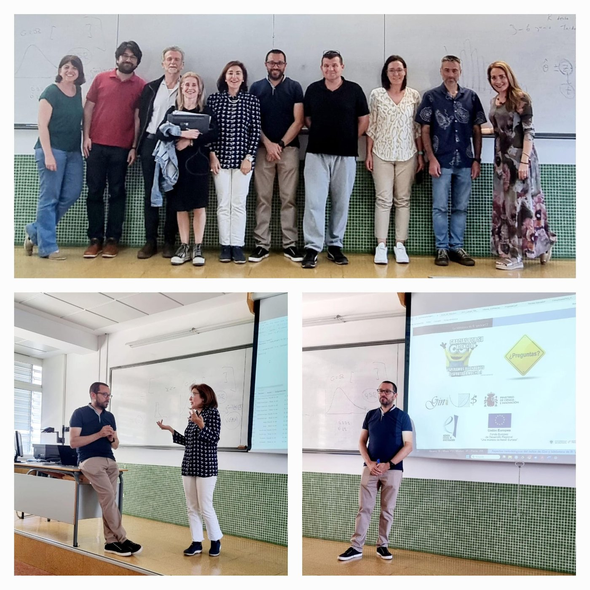

## Seminars

### 22 May 2024 · Methodological aspects of the Gini index and the R package giniVarCI

*Aspectos metodológicos del índice de Gini y biblioteca de R giniVarCI para su estimación y construcción de intervalos de confianza.* E. Álvarez, P.J. Moya, J.F. Muñoz and J.M. Pavía. Seminar organised by the research group [EPIC (Economía Pública y Globalización, SEJ-393)](https://epic.ugr.es/en), University of Granada.

{.photo fig-alt="Participants in the seminar on the Gini index and the R package giniVarCI, University of Granada, 22 May 2024"}

## Conferences

Conferences where the results of the project are presented will be listed here.

### Upcoming conferences (2027) {#upcoming-conferences-2027}

Conferences of interest for the project with confirmed dates for 2027. Dates and venues are taken from the official websites (checked in November 2026); please check them before planning a trip.

::: {.conf-table}

| Dates | Conference | Venue | Why it matters for GiniUs |
|---|---|---|---|
| February 2027 | [3rd III/LIS Comparative Economic Inequality Conference](https://inomics.com/conference/3rd-iiilis-comparative-economic-inequality-conference-1554545) | London School of Economics, London (UK) | Comparative measurement of income inequality |
| 24–25 May 2027 | [IARIW–WIUT Conference: Measuring Income, Wealth, and Well-being in Central Asia, the Caucasus, and Neighboring Regions](https://iariw.org/iariw-wiut-conference-may-2027/) | Westminster International University in Tashkent (Uzbekistan) | Inequality measurement; abstracts due **25 November 2026**; selected papers in the *Review of Income and Wealth* |
| 6–9 July 2027 | [10th International Conference on Econometrics and Statistics (EcoSta 2027)](https://www.cmstatistics.org/EcoSta2027/) | ShanghaiTech University, Shanghai (China) | Bias correction and inference for the Gini index (OG1, OG2) |
| 11–15 July 2027 | [66th ISI World Statistics Congress (WSC 2027)](https://www.isi-next.org/conferences/isi-wsc2027/) | Lusaka (Zambia) | Official statistics and inequality indicators; transfer to statistical offices |
| 19–23 July 2027 | [12th Conference of the European Survey Research Association (ESRA 2027)](https://www.europeansurveyresearch.org/) | Paris (France), jointly with WAPOR | Survey data, non-response and missing data (OG2) |
| 31 Aug – 3 Sep 2027 | [12th ECINEQ Conference](https://www.ecineq.org/2026/06/13/12th-ecineq-conference-2027/) | UNU-WIDER, Helsinki (Finland); policy event on 31 August | The main international meeting on economic inequality |
| 22–24 September 2027 | [EnvStat27 – Environmental Statistics and Data Science](https://boku.ac.at/en/nwnr/stat/conferences-and-events/envstat27) | BOKU University, Vienna (Austria) | Statistical methods for water applications (OG4) |

:::

Other regular meetings of interest whose 2027 dates have not yet been announced: the Spring Servitization Conference, the useR! conference, the SEIO and ASEPELT congresses, COMPSTAT and CMStatistics.

## Research stays

The project plans research stays at the centres of its foreign members (University of Glasgow, University of Edinburgh and University of Modena and Reggio Emilia), with seminars to disseminate the results. Completed stays will be listed here.

## Final international workshop

An international workshop will be organised at the end of the project (2027) to disseminate the results, with institutions interested in inequality and missing data such as the Spanish Statistical Office (INE).

## Inequality in the news

- **2025 · Eurostat.** [Inequality in enlargement countries](https://ec.europa.eu/eurostat/statistics-explained/index.php?title=Inequality_in_enlargement_countries&oldid=681506).
- **2024 · World Bank.** [The geography of high inequality: monitoring the World Bank's new indicator](https://blogs.worldbank.org/en/opendata/the-geography-of-high-inequality--monitoring-the-world-bank-s-ne).
- **2023 · World Bank.** [2023 in nine charts: a growing inequality](https://www.worldbank.org/en/news/feature/2023/12/18/2023-in-nine-charts-a-growing-inequality).
- **2023 · World Economic Forum.** [Global inequality is a failure of imagination](https://www.weforum.org/agenda/2023/01/global-inequality-is-a-failure-of-imagination/).
- **2023 · National Review.** [Was the panic over 'income inequality' all based on a mistake?](https://www.nationalreview.com/2023/12/was-the-panic-over-income-inequality-all-based-on-a-mistake/)
- **2023 · World Economic Forum (Davos).** José María Álvarez-Pallete: [inequality is the greatest challenge that society faces in the change of era brought by digital transformation](https://www.bnamericas.com/en/news/alvarez-pallete-reskilling-and-technology-are-part-of-the-solution-to-the-problem-of-inequality).
