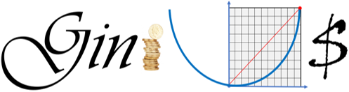

{width=40% fig-alt="GiniUs logo"}

## Definitions

Let $Y$ be a non-negative continuous random variable with distribution function $F_Y$ and mean $\mu_Y = E[Y]=\int_0^{\infty} y\,dF_Y(y)$. The Gini index has several equivalent definitions.

**Definition 1** (Lorenz, 1905; Langel and Tillé, 2013). Twice the area between the line of equality and the Lorenz curve $L_\alpha$:
$$
G = 2\left(0.5 - \int_{0}^{1} L_{\alpha}\, d\alpha \right), \qquad
L_{\alpha} = \frac{1}{\mu_{Y}}\int_{0}^{Y_{\alpha}}y\,dF_{Y}(y)=\frac{1}{\mu_{Y}}\int_{0}^{\alpha}Y_{u}\,du,
$$
where $Y_{\alpha}=F_{Y}^{-1}(\alpha)=\inf\{t:F_{Y}(t)\geq \alpha\}$ is the $\alpha$-quantile of $Y$.

**Definition 2** (Kendall and Stuart, 1977). Half the relative mean absolute difference:
$$
G = \frac{D_{G}}{2 \mu_{Y}}, \qquad D_{G}=E|X-Y|=\int_{0}^{\infty}\!\!\int_{0}^{\infty} |x-y|\,dF_{Y}(x)\,dF_{Y}(y).
$$

**Definition 3** (Qin et al., 2010; Berger and Gedik-Balay, 2020):
$$
G=\frac{1}{\mu_{Y}}\int_{0}^{\infty}\{2F_{Y}(y)-1\}\,y\,dF_{Y}(y)=1 - \frac{1}{\mu_{Y}}\int_{0}^{\infty}\{1-F_{Y}(y)\}^{2}dy.
$$

**Definition 4** (Anand, 1983; Lerman and Yitzhaki, 1984):
$$
G=\frac{2}{\mu_{Y}}\,\mathrm{cov}\{Y, F_{Y}(Y)\}.
$$

**Definition 5** (Yitzhaki, 1998; Peng, 2011; Berger and Gedik-Balay, 2020):
$$
G=1 - \frac{\mu_{Z}}{\mu_{Y}}, \qquad \mu_{Z} = E(Z)= \int_{0}^{\infty}\{1-F_{Z}(z)\}\,dz,
$$
where $Z=\min\{Y_{a}, Y_{b}\}$ and $Y_{a}$, $Y_{b}$ are independent copies of $Y$.

::: {.callout-tip appearance="simple"}
All these estimators, with variances and confidence intervals, are implemented in the R package [**giniVarCI**](software.qmd), developed in this project: `install.packages("giniVarCI")`.
:::

## Estimation in infinite populations

We use a sample of size $n=50$ from a Pareto distribution. The R functions below are written in base R so that they can be read and checked easily; **giniVarCI** computes them much faster with C++ code.

```{r}
# Sample selection (Pareto distribution with scale 1 and shape 1.5, by inversion)
set.seed(123)
rpareto_base <- function(n, scale = 1, shape) scale / runif(n)^(1 / shape)
Y.n <- rpareto_base(n = 50, shape = 1.5)
round(Y.n, 3)
```

**Estimator $\widehat{G}_{n}^{a}$:**
$$\widehat{G}_{n}^{a}= \frac{1}{n\overline{y}}\sum_{i \in S}\{2\widehat{F}_{n}(y_{i})-1\}y_{i}= \frac{1}{T}\sum_{i \in S}\{2\widehat{F}_{n}(y_{i})-1\}y_{i},\qquad T=\sum_{i \in S}y_{i}.$$

```{r}
Gn.a <- function(y) {
  FDi <- sapply(y, function(Yi) mean(y <= Yi))
  (1 / sum(y)) * sum((2 * FDi - 1) * y)
}
Gn.a(Y.n)
```

**Estimator $\widehat{G}_{n}^{b}$:**
$$\widehat{G}_{n}^{b}=\frac{1}{2n^{2}\overline{y}}\sum_{i \in S}\sum_{j \in S}|y_{i}-y_{j}|=\frac{1}{2nT}\sum_{i \in S}\sum_{j \in S}|y_{i}-y_{j}|.$$

```{r}
Gn.b <- function(y) {
  n <- length(y)
  ABSi <- sapply(y, function(Yi) sum(abs(y - Yi)))
  sum(ABSi) / (2 * n * sum(y))
}
Gn.b(Y.n)
```

**Estimators $\widehat{G}_{n}^{b1}$, $\widehat{G}_{n}^{b2}$ and $\widehat{G}_{n}^{b3}$** (equivalent expressions of $\widehat{G}_{n}^{b}$ based on the ordered sample $y_{(1)}\le\cdots\le y_{(n)}$):
$$\widehat{G}_{n}^{b1} = \frac{2}{nT}\sum_{i=1}^{n} i\, y_{(i)} - \frac{n+1}{n},\qquad
\widehat{G}_{n}^{b2} = \frac{2\widehat{\beta}}{n} - \frac{n+1}{n},\quad \widehat{\beta}=\frac{1}{T}\sum_{i=1}^{n} i\,y_{(i)},\qquad
\widehat{G}_{n}^{b3} = \frac{2}{T}\,\mathrm{cov}(i, y_{(i)}).$$

```{r}
Gn.b1 <- function(y) { n <- length(y); (2 / (n * sum(y))) * sum((1:n) * sort(y)) - (n + 1) / n }
Gn.b2 <- function(y) { n <- length(y); Beta <- sum((1:n) * sort(y)) / sum(y); 2 * Beta / n - (n + 1) / n }
Gn.b3 <- function(y) { n <- length(y); (2 / sum(y)) * (mean((1:n) * sort(y)) - mean(1:n) * mean(y)) }
c(b1 = Gn.b1(Y.n), b2 = Gn.b2(Y.n), b3 = Gn.b3(Y.n))
```

**Estimator $\widehat{G}_{n}^{c}$** (bias-corrected version):
$$\widehat{G}_{n}^{c}= \frac{n}{n-1}\widehat{G}_{n}^{b}=\frac{1}{2(n-1)T}\sum_{i \in S}\sum_{j \in S}|y_{i}-y_{j}|.$$

```{r}
Gn.c <- function(y) { n <- length(y); n * Gn.b(y) / (n - 1) }
Gn.c(Y.n)
```

**Estimators $\widehat{G}_{n}^{c1}$, $\widehat{G}_{n}^{c2}$ and $\widehat{G}_{n}^{c3}$:**
$$\widehat{G}_{n}^{c1} = \frac{2}{(n-1)T}\sum_{i=1}^{n} i\, y_{(i)} - \frac{n+1}{n-1},\qquad
\widehat{G}_{n}^{c2} = \frac{1}{2\overline{y}}\binom{n}{2}^{-1}\sum_{1 \leq i_{1} < i_{2} \leq n} |y_{i_{1}}-y_{i_{2}}|,\qquad
\widehat{G}_{n}^{c3} = 1 - \frac{\overline{z}}{\overline{y}},$$
where $z_i = (n-1)^{-1}\sum_{j\neq i}\min(y_i,y_j)$.

```{r}
Gn.c1 <- function(y) { n <- length(y); (2 / ((n - 1) * sum(y))) * sum((1:n) * sort(y)) - (n + 1) / (n - 1) }
Gn.c2 <- function(y) {
  n <- length(y); pairs <- combn(n, 2)
  (1 / (2 * mean(y))) * sum(abs(y[pairs[1, ]] - y[pairs[2, ]])) / choose(n, 2)
}
Gn.c3 <- function(y) {
  n <- length(y)
  zi <- sapply(1:n, function(i) sum(pmin(y[-i], y[i]))) / (n - 1)
  1 - mean(zi) / mean(y)
}
c(c1 = Gn.c1(Y.n), c2 = Gn.c2(Y.n), c3 = Gn.c3(Y.n))
```

## Estimation in finite populations

A sample of size $n=50$ is selected by simple random sampling without replacement from a population of size $N=10{,}000$ generated from a Pareto distribution. The survey weights are $w_i = N/n$.

```{r}
set.seed(123)
Y.N <- rpareto_base(n = 10000, shape = 1.5)
Y.n <- sample(Y.N, size = 50)
w.n <- rep(10000 / 50, 50)
```

**Estimator $\widehat{G}_{w}^{a}$:**
$$\widehat{G}_{w}^{a}= \frac{2}{\widehat{N}\overline{y}_{w}}\sum_{i \in S}w_{i}y_{i}\widehat{F}_{w}(y_{i})-1.$$

```{r}
Gw.a <- function(y, w) {
  N.Hat <- sum(w)
  FDi <- sapply(y, function(Yi) sum(w * (y <= Yi)) / N.Hat)
  Mean.y <- sum(w * y) / N.Hat
  (2 / (N.Hat * Mean.y)) * sum(w * y * FDi) - 1
}
Gw.a(Y.n, w.n)
```

**Estimator $\widehat{G}_{w}^{b}$:**
$$\widehat{G}_{w}^{b}=\frac{1}{2\widehat{N}^{2}\overline{y}_{w}}\sum_{i \in S}\sum_{j \in S}w_{i}w_{j}|y_{i}-y_{j}|.$$

```{r}
Gw.b <- function(y, w) {
  N.Hat <- sum(w)
  ABSi <- sapply(y, function(Yi) sum(w * abs(y - Yi)))
  Mean.y <- sum(w * y) / N.Hat
  sum(w * ABSi) / (2 * N.Hat^2 * Mean.y)
}
Gw.b(Y.n, w.n)
```

**Estimator $\widehat{G}_{w}^{c}$:**
$$\widehat{G}_{w}^{c} =1 - \frac{\overline{z}_{w}}{\overline{y}_{w}}.$$

```{r}
Gw.c <- function(y, w) {
  N.Hat <- sum(w); n <- length(y)
  zi <- sapply(1:n, function(i) sum(w[-i] * pmin(y[-i], y[i])) / (N.Hat - w[i]))
  1 - (sum(w * zi) / N.Hat) / (sum(w * y) / N.Hat)
}
Gw.c(Y.n, w.n)
```

## With the R package giniVarCI

```{r}
#| eval: false
install.packages("giniVarCI")
library(giniVarCI)

# Infinite populations: estimate with bias correction and confidence interval
igini(Y.n)                              # point estimate
igini(Y.n, interval = "zjackknife")     # jackknife interval
icompareCI(Y.n, plotCI = TRUE)          # compares all the intervals

# Finite populations: survey weights
fgini(Y.n, w.n, interval = "zalinearization")
```

See the [giniVarCI page](software.qmd) for more examples.

## References

Anand, S. (1983). *Inequality and Poverty in Malaysia: Measurement and Decomposition*. The World Bank.\
Berger, Y.G., & Gedik-Balay, İ. (2020). Confidence intervals of Gini coefficient under unequal probability sampling. *Journal of Official Statistics*, 36(2), 237–249.\
Kendall, M., & Stuart, A. (1977). *The Advanced Theory of Statistics. Vol. 1: Distribution Theory*. Griffin.\
Langel, M., & Tillé, Y. (2013). Variance estimation of the Gini index: revisiting a result several times published. *JRSS A*, 176(2), 521–540.\
Lerman, R.I., & Yitzhaki, S. (1984). A note on the calculation and interpretation of the Gini index. *Economics Letters*, 15(3–4), 363–368.\
Lorenz, M.O. (1905). Methods of measuring the concentration of wealth. *Publications of the American Statistical Association*, 9(70), 209–219.\
Peng, L. (2011). Empirical likelihood methods for the Gini index. *Australian & New Zealand Journal of Statistics*, 53(2), 131–139.\
Qin, Y., Rao, J.N.K., & Wu, C. (2010). Empirical likelihood confidence intervals for the Gini measure of income inequality. *Economic Modelling*, 27(6), 1429–1435.\
Yitzhaki, S. (1998). More than a dozen alternative ways of spelling Gini. *Research on Economic Inequality*, 8, 13–30.
