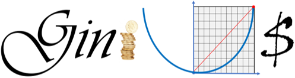
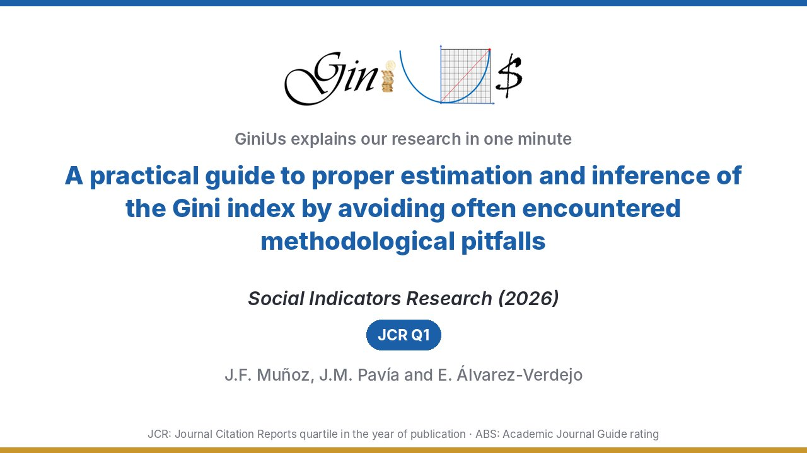
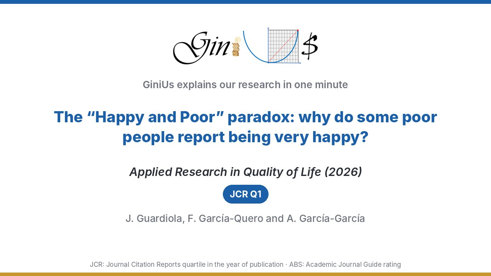
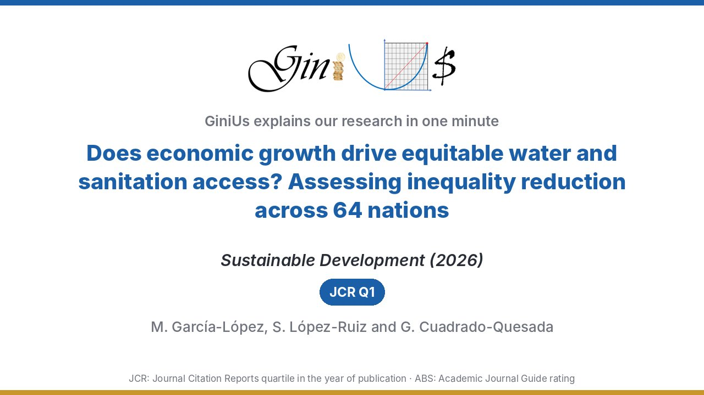
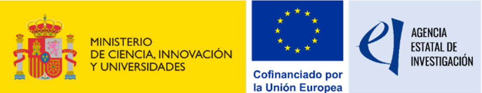

::: {.hero}
{width=62% fig-alt="GiniUs logo: the word Gini with coins, a Lorenz curve and the dollar sign"}

Challenges for the analysis of inequality with applications in the Social Sciences: using new methodological developments to avoid biases and errors in the Gini index.

Research project · In progress (2023–2027)

:::

## Project status



## About GiniUs

**GiniUs** is a research project of the University of Granada (Spain), funded by the Spanish State Research Agency, that makes methodological contributions to the measurement of **inequality** through the **Gini index**, the most widely used inequality indicator.

Inequality is a priority challenge of the UN 2030 Agenda, Horizon Europe and the Spanish State Plan for Scientific, Technical and Innovation Research. To design sound policies, inequality must be measured without biases or errors. However, the Gini index is always **estimated from samples**, and the project has shown that:

- there are many **different estimators** of the Gini index, which give different results;
- some of them have **large biases** when data have low inequality, or are highly skewed and unequal;
- **missing data**, very common in income surveys, can bias the Gini index, and the way they are treated matters;
- statistical **software** for the Gini index rarely provides variances and confidence intervals.

GiniUs develops solutions to these problems, publishes them in leading journals, implements them in the open-source R package [**giniVarCI**](software.qmd), and applies them in three areas of the Social Sciences: **water economics**, **tourism** and **business management**.

## The project at a glance

::: {.obs-grid}
::: {.obs-card}
**OG1 · Bias of the Gini index**\
Identify and reduce the bias of Gini estimators. [Explore the bias →](simulation.qmd)
:::
::: {.obs-card}
**OG2 · Missing data**\
Identify and reduce the impact of missing data on the Gini index. [Try the simulator →](missing-data.qmd)
:::
::: {.obs-card}
**OG3 · Open software**\
The R package giniVarCI, available on CRAN. [See the package →](software.qmd)
:::
::: {.obs-card}
**OG4 · Applications and social impact**\
Water, tourism, business management and gender inequality. [Objectives →](project.qmd)
:::
::: {.obs-card}
**OG5 · Dissemination**\
Publications, conferences, seminars and research stays. [Publications →](publications.qmd)
:::
:::

## Our research in one minute

Research on inequality should reach everyone. Our **one-minute videos** explain the articles of the team in plain language: the question, what was found and why it matters for society.

::: {.video-grid}
<a href="videos.html#gini-practical-guide">How to estimate the Gini index without errors</a>
<a href="videos.html#happy-and-poor">The "happy and poor" paradox</a>
<a href="videos.html#water-sanitation-growth">Does growth make access to water more equal?</a>

:::

[See all the videos →](videos.qmd){.btn .btn-primary .btn-sm}

## Latest news

::: {.news-mini}
- **November 2026** · [Our research in one minute](videos.qmd): eight short videos explain the team's articles on inequality and poverty in plain language.
- **November 2026** · New website, with a [Gini index calculator](calculator.qmd), a [missing data simulator](missing-data.qmd), an [interactive bias explorer](simulation.qmd), [R exercises in your browser](practice.qmd) and an [inequality observatory](observatory.qmd).
- **23 October 2026** · The project takes part in the [IX EIEE](dissemination.qmd#eiee) (Ciudad Real).
- **10 September 2026** · [Working group on inequality](dissemination.qmd#aecpa) organised by members of the project at the XVIII AECPA Congress (Granada).
- **2026** · *A practical guide to proper estimation and inference of the Gini index*, published in *Social Indicators Research*.
:::

[All news →](news.qmd){.btn .btn-outline-primary .btn-sm}

## What this website offers

1. **Communication and collaboration.** Data, R code, results and conclusions are shared among the members of the project.
2. **Reproducible research.** Anyone can run the [R code](data-code.qmd) and obtain the same results.
3. **Interactivity.** The [bias explorer](simulation.qmd) and the [missing data simulator](missing-data.qmd) run Monte Carlo experiments in your browser under many scenarios.
4. **Tools.** The [calculator](calculator.qmd) estimates the Gini index of your own data with its standard error and confidence interval, and the [R exercises](practice.qmd) run in your browser without installing anything.
5. **Inequality observatory.** The [observatory](observatory.qmd) shows official Gini indices from Eurostat, the World Bank and the Spanish Statistical Office (INE).
6. **Science communication.** [One-minute videos](videos.qmd) explain our articles on inequality in plain language, so that the results reach society.
7. **Dissemination and internationalisation.** Results, data and software are openly available to researchers worldwide.

## Funding

::: {.funders}
{fig-alt="Ministerio de Ciencia, Innovación y Universidades; Cofinanciado por la Unión Europea; Agencia Estatal de Investigación"}
:::

Project <b>PID2022-136235NB-I00</b> funded by <b>MICIU/AEI/10.13039/501100011033</b> and by <b>ERDF/EU</b>. Knowledge Generation Projects, 2022 call. Duration: 1 September 2023 – 31 August 2027.

## Your opinion

Is this website useful to you? Rate it with one click and leave us your recommendations.


