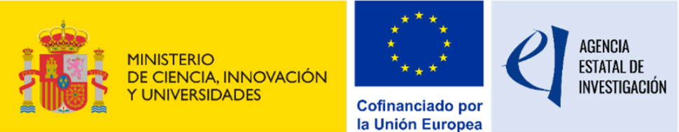



GiniUs is a non-oriented research project (Knowledge Generation Projects, 2022 call). Its general objectives (OG) and specific objectives (OE) respond to the [research questions](research.qmd) of the project. Studies based on data that include income and sex also analyse **income inequality** and **gender inequality**.

::: {.og-card}
### OG1 · Identify and reduce the bias in studies based on the Gini index

Coordinator: J.F. Muñoz · Researchers: E. Álvarez, Y.G. Berger, R.M. García, P.J. Moya, J.F. Muñoz · Data: EU-SILC and continuous distributions (Pareto, Dagum, lognormal, Gamma, Weibull) · Status: ✔ achieved (OE1–OE4 completed; results published in *Sociological Methods & Research* and *Social Indicators Research*, and implemented in giniVarCI)

<b>OE1.</b> Collect and classify all the expressions of the Gini index and analyse their properties and relationships, to resolve the controversy about the optimal expression to use in empirical studies (Q1).

<b>OE2.</b> Detect the scenarios in which the Gini index has excessively large biases, and identify the characteristics of the data that cause them (Q2, Q3).

<b>OE3.</b> Propose new techniques (bootstrap, jackknife and empirical bootstrap) to reduce the biases detected and avoid invalid inferences and wrong conclusions (Q4).

<b>OE4.</b> Establish a simple and practical criterion, based on skewness, inequality and sample size, that allows empirical users to detect large biases and recommends the use of correction techniques (Q5).

:::

::: {.og-card}
### OG2 · Identify and reduce the impact of missing data on the Gini index

Coordinator: J.F. Muñoz · Researchers: E. Álvarez, J. Chica, I. García, R.M. García, P.J. Moya, J.F. Muñoz · Data: EU-SILC and continuous distributions · Status: in progress

<b>OE5.</b> Analyse the impact of missing data on the estimation of the Gini index, in terms of skewness, inequality and type of non-response mechanism, and create a criterion to decide when an imputation technique is required (Q6). Try the [missing data simulator](missing-data.qmd).

<b>OE6.</b> Analyse multiple imputation techniques for the Gini index: response mechanism, imputation model, correlation between variables, number of imputations and iterations, skewness and inequality, bias, efficiency and confidence intervals (Q7).

:::

::: {.og-card}
### OG3 · Develop open and international software to compute the Gini index

Coordinator: J.F. Muñoz · Researchers: E. Álvarez, J. Chica, Y.G. Berger, P.J. Moya, J.F. Muñoz · Status: achieved — R package [giniVarCI](software.qmd) on CRAN

<b>OE7.</b> Develop the specialised R library that computes all the expressions of the Gini index, their variances and confidence intervals, for finite and infinite populations, and disseminate the results through this open library, the project website, RPubs and R forums (Q8).

:::

::: {.og-card}
### OG4 · Promote the multidisciplinary character and the social impact

Coordinators: J.F. Muñoz and F.J. González · Researchers: all · Lines: water economics, tourism, strategic management and international business · Status: in progress

<b>OE8.</b> Prepare methodological contributions that transfer the results of OG1 and OG3 so that researchers in the Social Sciences can carry out inequality studies with scientific and technical rigour (Q10).

<b>OE9.</b> Prepare methodological contributions that transfer the results of OG2 and OG3 to studies with missing information (Q11).

<b>OE10.</b> Promote the social impact through inequality studies, with or without missing information, on challenges of the 2030 Agenda, Horizon Europe and the Spanish State Plan: worldwide inequality in water consumption and availability, inequality in water prices between Spanish cities, tourism and gender, and the effect of tourism on inequality.

:::

::: {.og-card}
### OG5 · Promote the dissemination, transfer and internationalisation of the results

Coordinators: J.F. Muñoz and F.J. González · Researchers: all · Status: in progress ([publications](publications.qmd), [seminars and conferences](dissemination.qmd))

<b>OE11.</b> Disseminate, transfer and internationalise the results, especially through publications in high-impact journals, specialised conferences, research seminars and workshops, and research stays at foreign centres (Glasgow, Edinburgh and Modena).

:::

## Activities and milestones

| OG | OE | Activity | Milestone |
|---|---|---|---|
| OG1 | OE1 | A1: Collect the expressions of the Gini index | h1: Table with references and summary |
| | | A2: Analysis of properties and relationships | h2: Scheme of properties and relationships |
| | OE2 | A3: Bias of the Gini index; validation of H1 and H2 | h3: Figures illustrating the biases |
| | OE3 | A4: Analysis of correction techniques | h4: Figures illustrating the solutions |
| | OE4 | A5: Algorithm for the bias criterion | h5: Figures and algorithm of the criterion |
| OG2 | OE5 | A6: Consequences of missing data | h6: Scheme of consequences |
| | | A7: Algorithm for the use of imputation | h7: Figures and algorithm of the criterion |
| | OE6 | A8: Literature reviews | h8: Table with references and summary |
| | | A9: Multiple imputation and the Gini index | h9: Figures illustrating the solutions |
| OG3 | OE7 | A10: Review of R libraries on the Gini index | h10: Table of libraries and summary |
| | | A11: Development of the R library | h11: Publication in R (CRAN) ✔ |
| | | A12: Dissemination (website/app, RPubs, forums) | h12: Publications in RPubs and forums |
| OG4 | OE8 | A13: Literature review | h13: Table with references and summary |
| | | A14: Methodological contributions | h14: Contribution completed |
| | OE9 | A15: Literature review | h15: Table with references and summary |
| | | A16: Methodological contributions | h16: Contribution completed |
| | OE10 | A17: Specific contributions | h17: Contribution completed |
| OG5 | OE11 | A18: Publications in journals | Articles submitted |
| | | A19: Participation in conferences | Certificates of attendance |
| | | A20: Research stays | Certificates of stays and seminars |
| | | A21: Organisation of workshops and seminars | Calls for workshops and seminars |
| | | A22: Other publications (media, social networks) | Publications in social networks and other media |

: Activities and milestones of the project. {tbl-colwidths="[8,8,48,36]"}

## Work plan

The activities of OG1 and OG2 are carried out first, because their results are needed for OG3 and OG4. Articles are submitted to journals from the first year onwards, results are presented at conferences before submission, research stays are scheduled in periods without teaching, seminars are organised regularly and an international workshop is held at the end of the project. After each publication, results are disseminated through the media, social networks and official institutions.

| Period | Main activities |
|---|---|
| Year 1 (Sep 2023 – Aug 2024) | A1–A3 (expressions and bias of the Gini index), A6 (consequences of missing data), A10 (review of R libraries), A13 (literature reviews), A17 |
| Year 2 (Sep 2024 – Aug 2025) | A3–A5 (bias, correction techniques and criterion), A6–A9 (missing data and multiple imputation), A10–A11 (R library), A14, A17 |
| Year 3 (Sep 2025 – Aug 2026) | A4–A5, A7–A9, A11–A12 (library and dissemination), A14–A16 (methodological contributions), A17 |
| Year 4 (Sep 2026 – Aug 2027) | A9, A11–A12, A16–A17, final international workshop |
| All years | A18–A22: publications, conferences, stays, seminars and dissemination |

## Data sources

- **EU-SILC** (2016–2020): European Union Statistics on Income and Living Conditions (Eurostat).
- **HFCN** (2013, 2016, 2020): Eurosystem Household Finance and Consumption Survey.
- **Water habits** (2022): survey of 2,400 individuals in Andalusia on water consumption habits, well-being, health and pro-environmental behaviour.
- **Water prices** (2022): price of water in more than 1,000 Spanish municipalities, to be updated to analyse inequality over time.
- **AQUASTAT** (1958–2019): FAO global information system on water resources and agricultural water management.
- **WBES** (2002–2020): World Bank Enterprise Survey of private firms in more than 130 countries.
- **Probabilistic data**: samples from Pareto, Dagum, lognormal, Gamma and Weibull distributions with different levels of skewness and inequality ([Research data and R code](data-code.qmd)).

## Target journals

| Journal | JCR category | Quality indicator |
|---|---|---|
| Sociological Methods & Research | Social Sciences, Mathematical Methods | D1 |
| Social Indicators Research | Social Sciences, Interdisciplinary | Q2 |
| Economic Modelling | Economics | Q1; ABS 2 |
| Quantitative Economics | Economics | Q2; ABS 4 |
| Journal of Economic Surveys | Economics | Q1; ABS 2 |
| Journal of Economic Inequality | Economics | Q3; ABS 2 |
| Journal of Statistical Software | Statistics & Probability | D1 |
| R Journal | Statistics & Probability | D1 |
| Int. J. Water Resources Development | Water Resources | Q1 |
| Urban Water Journal | Water Resources | Q2 |
| Public Administration Review | Public Administration | D1; ABS 4\* |
| Public Administration | Public Administration | Q1; ABS 4 |
| Annals of Tourism Research | Hospitality, Leisure, Sport & Tourism | D1; ABS 4\* |
| Journal of Sustainable Tourism | Hospitality, Leisure, Sport & Tourism | D1; ABS 3 |
| Current Issues in Tourism | Hospitality, Leisure, Sport & Tourism | Q1; ABS 2 |
| International Journal of Tourism Research | Hospitality, Leisure, Sport & Tourism | Q2; ABS 2 |
| Tourism Management | Management; Hospitality, Leisure, Sport & Tourism | D1; ABS 4 |
| Global Strategy Journal | Management | Q1; ABS 4 |
| Journal of World Business | Business | Q1; ABS 4 |
| Strategic Management Journal | Business; Management | D1; ABS 4\* |
| Journal of International Business Studies | Business; Management | D1; ABS 4\* |

: Target journals of the project, with the indicators at the time of the proposal (2022). {tbl-colwidths="[42,38,20]"}

## Data management and reproducibility

The data management plan follows the **FAIR** principles (Findable, Accessible, Interoperable, Reusable). Data from official sources (EU-SILC, HFCN, AQUASTAT, WBES) are available from those institutions. Data generated from probability distributions are included in the R package and stored in the institutional repository [DIGIBUG](https://digibug.ugr.es/) of the University of Granada; the water datasets will be deposited at the Centre for Sociological Research (CIS) once the corresponding articles are published. Analyses are carried out with R and R Markdown/Quarto, fixing random seeds with `set.seed()` so that every result can be replicated.

## Gender perspective

Gender inequality is one of the most important applications of inequality analysis. EU-SILC and HFCN allow the data to be disaggregated by sex, so the studies are also carried out by sex: for example, whether the non-response mechanism, the impact of missing data, the biases, the skewness or the optimal imputation technique differ between women and men.

## Funding

::: {.funders}
{fig-alt="Ministerio de Ciencia, Innovación y Universidades; Cofinanciado por la Unión Europea; Agencia Estatal de Investigación"}
:::

Project <b>PID2022-136235NB-I00</b> funded by MICIU/AEI/10.13039/501100011033 and by ERDF/EU. Principal investigators: Juan Francisco Muñoz Rosas and Francisco José González Gómez (University of Granada). Budget: €86,875. Duration: 1 September 2023 – 31 August 2027.

