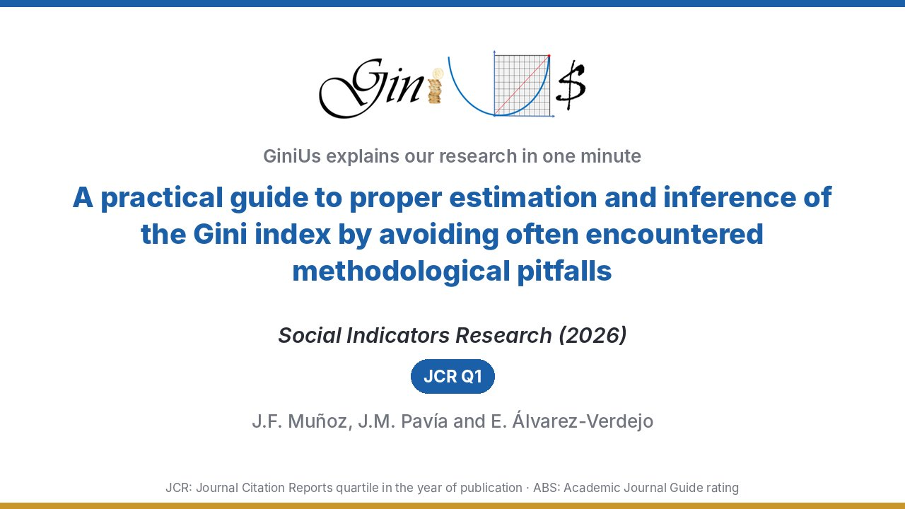
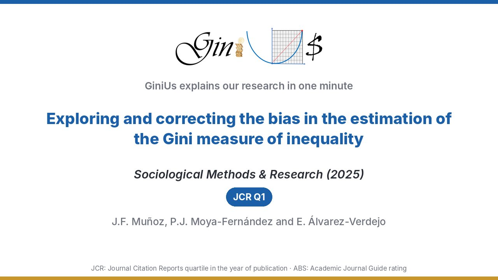
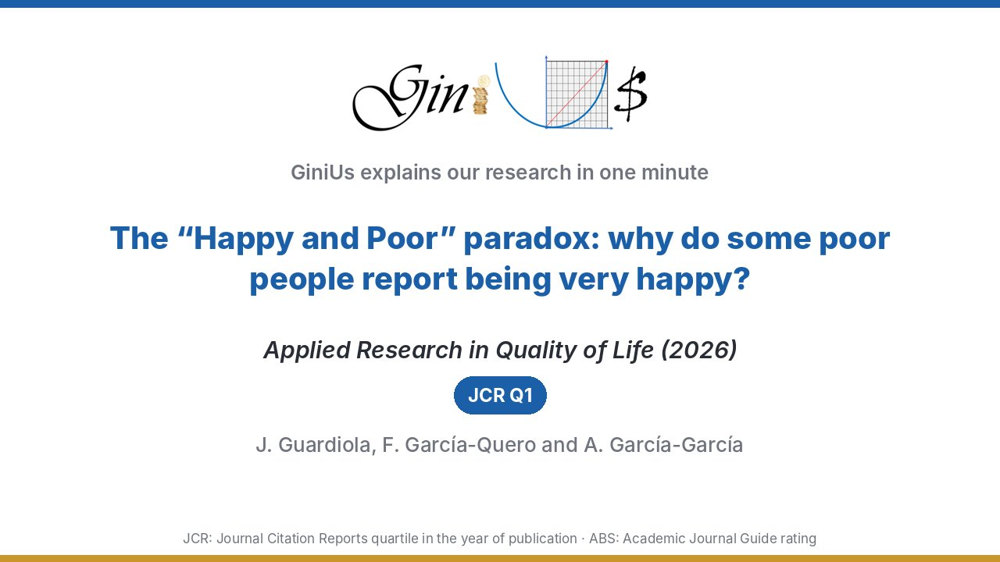
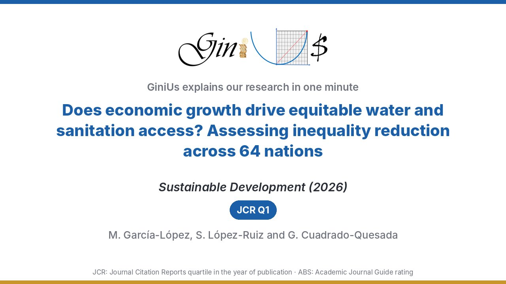
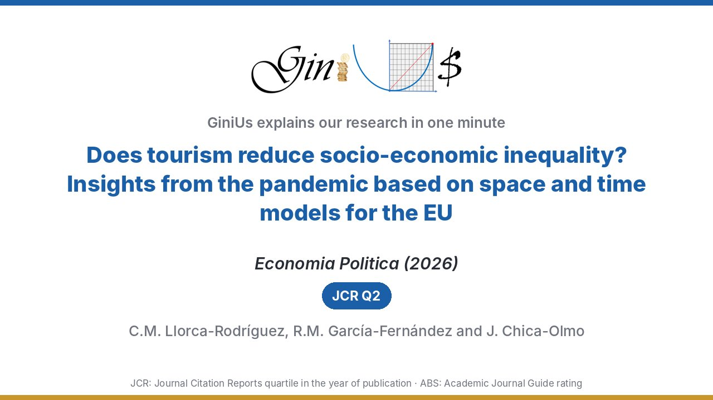
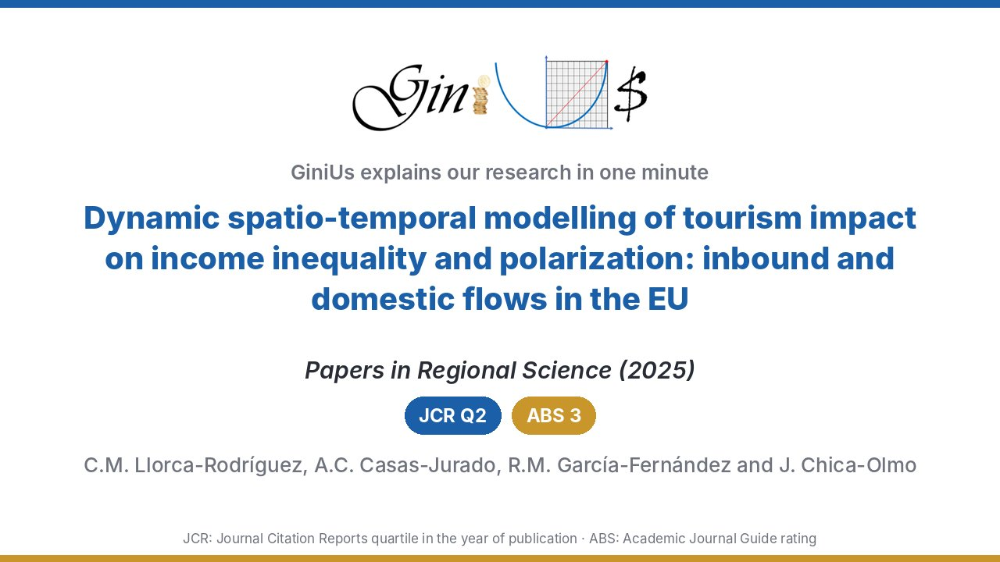
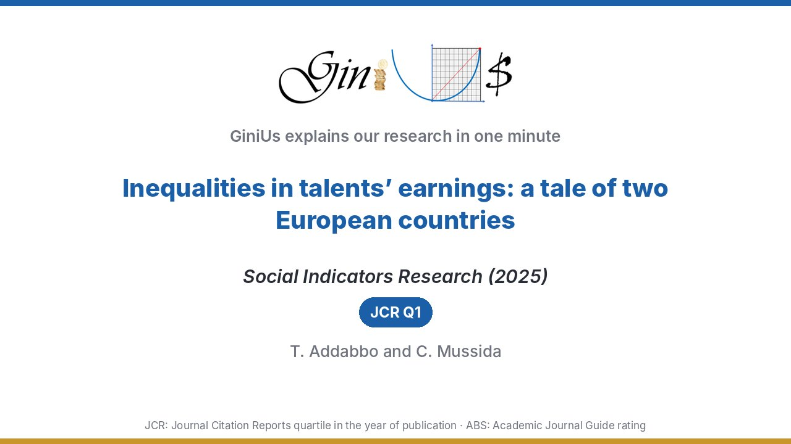
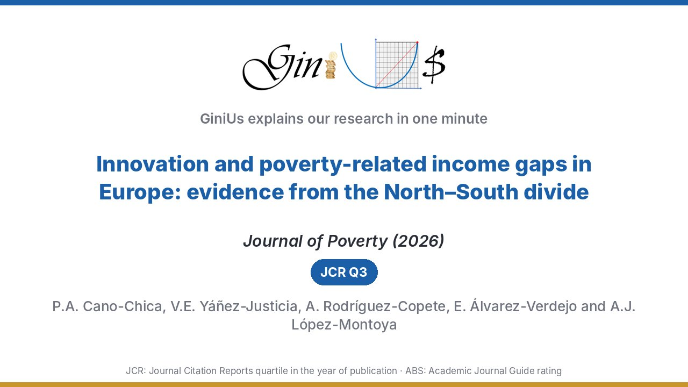

Research on inequality should reach everyone, not only specialists. Each of these **one-minute videos** explains an article of the team in plain language: the question, how it was answered, what was found and why it matters for society. You can share them freely on social networks, in classes or in public talks, citing GiniUs. Each video shows the quality indicators of the journal: JCR quartile in the year of publication and, where applicable, rating in the Chartered ABS *Academic Journal Guide*.

::: {.video-grid}
<a href="#gini-practical-guide"><span class="vt">A practical guide to proper estimation and inference of the Gini index by avoiding often encountered methodological pitfalls</span></a>
<a href="#gini-bias"><span class="vt">Exploring and correcting the bias in the estimation of the Gini measure of inequality</span></a>
<a href="#happy-and-poor"><span class="vt">The “Happy and Poor” paradox: why do some poor people report being very happy?</span></a>
<a href="#water-sanitation-growth"><span class="vt">Does economic growth drive equitable water and sanitation access? Assessing inequality reduction across 64 nations</span></a>
<a href="#tourism-poverty-pandemic"><span class="vt">Does tourism reduce socio-economic inequality? Insights from the pandemic based on space and time models for the EU</span></a>
<a href="#tourism-inequality-polarization"><span class="vt">Dynamic spatio-temporal modelling of tourism impact on income inequality and polarization: inbound and domestic flows in the EU</span></a>
<a href="#talents-earnings"><span class="vt">Inequalities in talents’ earnings: a tale of two European countries</span></a>
<a href="#innovation-poverty-gaps"><span class="vt">Innovation and poverty-related income gaps in Europe: evidence from the North–South divide</span></a>

:::

::: {#gini-practical-guide .video-card}
### A practical guide to proper estimation and inference of the Gini index by avoiding often encountered methodological pitfalls

<p class="meta">J.F. Muñoz, J.M. Pavía and E. Álvarez-Verdejo · <i>Social Indicators Research</i> (2026) · <b>JCR Q1</b> · <a href="https://doi.org/10.1007/s11205-026-03831-x" target="_blank">doi.org/10.1007/s11205-026-03831-x</a></p>

```{=html}
<video controls preload="none" poster="media/videos/gini-practical-guide.jpg" aria-label="One-minute video: A practical guide to proper estimation and inference of the Gini index by avoiding often encountered methodological pitfalls"><source src="media/videos/gini-practical-guide.mp4" type="video/mp4">Your browser does not support HTML5 video. <a href="media/videos/gini-practical-guide.mp4">Download the video</a>.</video>
```

**The question.** The Gini index is the most used measure of inequality. But computing it from data is error-prone. Do common practices give wrong numbers and wrong margins of error?

**What they found.** Some widely used formulas give inaccurate estimates of inequality. A popular regression-based method seriously underestimates the margin of error when incomes are very skewed and unequal. Jackknife methods give the most accurate margins of error.

**Why it matters.** Margins of error that are too small can make us believe inequality changed when it did not. The paper gives practical recommendations and the free R package giniVarCI.

[Download the video (MP4)](media/videos/gini-practical-guide.mp4){.btn .btn-outline-primary .btn-sm download=""}
:::

::: {#gini-bias .video-card}
### Exploring and correcting the bias in the estimation of the Gini measure of inequality

<p class="meta">J.F. Muñoz, P.J. Moya-Fernández and E. Álvarez-Verdejo · <i>Sociological Methods & Research</i> (2025) · <b>JCR Q1</b> · <a href="https://doi.org/10.1177/00491241231176847" target="_blank">doi.org/10.1177/00491241231176847</a></p>

```{=html}
<video controls preload="none" poster="media/videos/gini-bias.jpg" aria-label="One-minute video: Exploring and correcting the bias in the estimation of the Gini measure of inequality"><source src="media/videos/gini-bias.mp4" type="video/mp4">Your browser does not support HTML5 video. <a href="media/videos/gini-bias.mp4">Download the video</a>.</video>
```

**The question.** There are many formulas to estimate the Gini index from a sample. Do they all give the right answer?

**What they found.** One popular formula strongly overestimates inequality when inequality is low. With skewed and unequal data, the usual estimators tend to underestimate inequality. Bootstrap and jackknife corrections reduce the bias, and a simple criterion tells when to use them.

**Why it matters.** Differences in inequality between countries, regions or groups can come from the formula used, not from real differences. Choosing the right estimator avoids wrong conclusions.

[Download the video (MP4)](media/videos/gini-bias.mp4){.btn .btn-outline-primary .btn-sm download=""}
:::

::: {#happy-and-poor .video-card}
### The “Happy and Poor” paradox: why do some poor people report being very happy?

<p class="meta">J. Guardiola, F. García-Quero and A. García-García · <i>Applied Research in Quality of Life</i> (2026) · <b>JCR Q1</b> · <a href="https://doi.org/10.1007/s11482-026-10637-z" target="_blank">doi.org/10.1007/s11482-026-10637-z</a></p>

```{=html}
<video controls preload="none" poster="media/videos/happy-and-poor.jpg" aria-label="One-minute video: The “Happy and Poor” paradox: why do some poor people report being very happy?"><source src="media/videos/happy-and-poor.mp4" type="video/mp4">Your browser does not support HTML5 video. <a href="media/videos/happy-and-poor.mp4">Download the video</a>.</video>
```

**The question.** Many people living in poverty say they are very happy. How can that be?

**Six explanations.** Their basic needs are met and they are satisfied in key areas of life; they adapt to hardship and have modest aspirations. Scientists and policymakers may misjudge how well they are doing. Their culture supports happiness, and maldevelopment has not eroded it.

**Why it matters.** Poverty is not only a lack of income. Listening to how people evaluate their own lives helps design better development policies.

[Download the video (MP4)](media/videos/happy-and-poor.mp4){.btn .btn-outline-primary .btn-sm download=""}
:::

::: {#water-sanitation-growth .video-card}
### Does economic growth drive equitable water and sanitation access? Assessing inequality reduction across 64 nations

<p class="meta">M. García-López, S. López-Ruiz and G. Cuadrado-Quesada · <i>Sustainable Development</i> (2026) · <b>JCR Q1</b> · <a href="https://doi.org/10.1002/sd.70894" target="_blank">doi.org/10.1002/sd.70894</a></p>

```{=html}
<video controls preload="none" poster="media/videos/water-sanitation-growth.jpg" aria-label="One-minute video: Does economic growth drive equitable water and sanitation access? Assessing inequality reduction across 64 nations"><source src="media/videos/water-sanitation-growth.mp4" type="video/mp4">Your browser does not support HTML5 video. <a href="media/videos/water-sanitation-growth.mp4">Download the video</a>.</video>
```

**The question.** When a country grows richer, does access to water and sanitation become more equal?

**What they found.** Growth improves access overall, but the poorest and rural populations are left behind. Inequality in sanitation is not related to growth. Unequal access to water also holds back GDP per capita.

**Why it matters.** Growth alone will not deliver water and sanitation for all (SDG 6). Effective governance and efficient water use are needed.

[Download the video (MP4)](media/videos/water-sanitation-growth.mp4){.btn .btn-outline-primary .btn-sm download=""}
:::

::: {#tourism-poverty-pandemic .video-card}
### Does tourism reduce socio-economic inequality? Insights from the pandemic based on space and time models for the EU

<p class="meta">C.M. Llorca-Rodríguez, R.M. García-Fernández and J. Chica-Olmo · <i>Economia Politica</i> (2026) · <b>JCR Q2</b> · <a href="https://doi.org/10.1007/s40888-025-00390-1" target="_blank">doi.org/10.1007/s40888-025-00390-1</a></p>

```{=html}
<video controls preload="none" poster="media/videos/tourism-poverty-pandemic.jpg" aria-label="One-minute video: Does tourism reduce socio-economic inequality? Insights from the pandemic based on space and time models for the EU"><source src="media/videos/tourism-poverty-pandemic.mp4" type="video/mp4">Your browser does not support HTML5 video. <a href="media/videos/tourism-poverty-pandemic.mp4">Download the video</a>.</video>
```

**The question.** Does tourism help to reduce poverty and social exclusion in European regions?

**What they found.** International (inbound) tourism increases poverty and social exclusion in destination regions. Domestic tourism reduces them, in destinations and in neighbouring regions. Some other effects are statistically significant but economically very small.

**Why it matters.** Tourism does not reduce poverty by itself. Market structures, labour regulation, competitiveness and social protection decide who benefits.

[Download the video (MP4)](media/videos/tourism-poverty-pandemic.mp4){.btn .btn-outline-primary .btn-sm download=""}
:::

::: {#tourism-inequality-polarization .video-card}
### Dynamic spatio-temporal modelling of tourism impact on income inequality and polarization: inbound and domestic flows in the EU

<p class="meta">C.M. Llorca-Rodríguez, A.C. Casas-Jurado, R.M. García-Fernández and J. Chica-Olmo · <i>Papers in Regional Science</i> (2025) · <b>JCR Q2 · ABS 3</b> · <a href="https://doi.org/10.1016/j.pirs.2025.100122" target="_blank">doi.org/10.1016/j.pirs.2025.100122</a></p>

```{=html}
<video controls preload="none" poster="media/videos/tourism-inequality-polarization.jpg" aria-label="One-minute video: Dynamic spatio-temporal modelling of tourism impact on income inequality and polarization: inbound and domestic flows in the EU"><source src="media/videos/tourism-inequality-polarization.mp4" type="video/mp4">Your browser does not support HTML5 video. <a href="media/videos/tourism-inequality-polarization.mp4">Download the video</a>.</video>
```

**The question.** Does tourism make income more equal in European regions, or less?

**What they found.** Overall, tourism and inequality follow an inverted-U shape. Inbound tourism increases inequality and polarization in destinations; domestic tourism reduces them. Both types improve the income distribution of neighbouring regions.

**Why it matters.** Useful for the EU Cohesion Policy: domestic tourism supports cohesion, and social protection (education, health, unemployment and retirement) should be strengthened.

[Download the video (MP4)](media/videos/tourism-inequality-polarization.mp4){.btn .btn-outline-primary .btn-sm download=""}
:::

::: {#talents-earnings .video-card}
### Inequalities in talents’ earnings: a tale of two European countries

<p class="meta">T. Addabbo and C. Mussida · <i>Social Indicators Research</i> (2025) · <b>JCR Q1</b> · <a href="https://doi.org/10.1007/s11205-025-03692-w" target="_blank">doi.org/10.1007/s11205-025-03692-w</a></p>

```{=html}
<video controls preload="none" poster="media/videos/talents-earnings.jpg" aria-label="One-minute video: Inequalities in talents’ earnings: a tale of two European countries"><source src="media/videos/talents-earnings.mp4" type="video/mp4">Your browser does not support HTML5 video. <a href="media/videos/talents-earnings.mp4">Download the video</a>.</video>
```

**The question.** Are young graduates paid differently in Italy and in Germany? And are women paid less than men?

**What they found.** The wage gap against Italian talents grew in 2022, mainly because the same qualifications are paid less. The gap grew more for women, especially at the top. Gender gap among talents: Italy from 10% to 22.5%; Germany from 27.5% to 15%.

**Why it matters.** Better pay and conditions in Germany help explain why young Italian talents move there. Policies are needed to attract and keep talent.

[Download the video (MP4)](media/videos/talents-earnings.mp4){.btn .btn-outline-primary .btn-sm download=""}
:::

::: {#innovation-poverty-gaps .video-card}
### Innovation and poverty-related income gaps in Europe: evidence from the North–South divide

<p class="meta">P.A. Cano-Chica, V.E. Yáñez-Justicia, A. Rodríguez-Copete, E. Álvarez-Verdejo and A.J. López-Montoya · <i>Journal of Poverty</i> (2026) · <b>JCR Q3</b> · <a href="https://doi.org/10.1080/10875549.2026.2671664" target="_blank">doi.org/10.1080/10875549.2026.2671664</a></p>

```{=html}
<video controls preload="none" poster="media/videos/innovation-poverty-gaps.jpg" aria-label="One-minute video: Innovation and poverty-related income gaps in Europe: evidence from the North–South divide"><source src="media/videos/innovation-poverty-gaps.mp4" type="video/mp4">Your browser does not support HTML5 video. <a href="media/videos/innovation-poverty-gaps.mp4">Download the video</a>.</video>
```

**The question.** How are innovation and entrepreneurship related to the income gaps that affect the poorest households in Europe?

**What the study analyses.** How innovation dynamics interact with income inequality and poverty-related vulnerability. Differences between Northern and Southern Europe. Changes within countries over time and differences between countries.

**Why it matters.** Innovation policies can widen or narrow income gaps. Knowing where and how helps to design fairer innovation policies in Europe.

[Download the video (MP4)](media/videos/innovation-poverty-gaps.mp4){.btn .btn-outline-primary .btn-sm download=""}
:::

::: {.callout-note appearance="simple"}
The videos summarise the published articles; for the full results and their limitations, please read the original articles. More videos will be added as new articles are published.
:::
